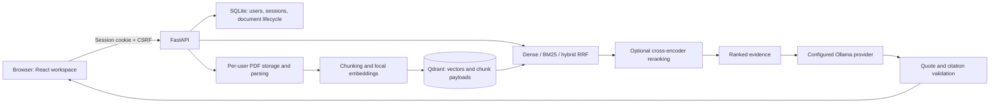

# Enterprise Multi-Document RAG Agent

An evidence-first assistant for searching PDF collections. It combines semantic
and lexical retrieval, can rerank candidates, and returns validated excerpts
with source and page citations. The browser workspace includes authenticated
document management and a grounded question interface.

> **Status:** The application, API, React frontend, tenant-scoped document
> lifecycle, and synthetic offline regression tests are implemented. A complete
> real-model deployment has not been validated in this environment. See
> [Current limits](#current-limits) before treating this as a production system.

## What it does

- Parses text-based PDFs and keeps page, heading, and source metadata.
- Splits documents into retrieval chunks and stores vectors and payloads in
  Qdrant.
- Supports dense semantic search, BM25 keyword search, and hybrid reciprocal
  rank fusion (RRF).
- Optionally reranks candidates with a cross-encoder.
- Uses an Ollama-compatible generation provider to select evidence under a
  structured response contract. The API verifies selected quotes and citation
  metadata before returning an answer.
- Provides a React workspace for login, PDF upload, processing status, document
  inventory and deletion, retrieval, answers, and source inspection.
- Derives each API tenant scope from the authenticated server-side user ID.
  Client-supplied tenant IDs are not accepted.

This is extractive, evidence-constrained answering, not unrestricted
summarization. A valid citation confirms that the quote exists in returned
evidence; it does not prove that retrieval found every relevant passage or that
the answer is factually complete.

## Architecture



SQLite owns authentication, sessions, rate-limit state, and the API-managed
document registry. Uploaded PDFs are stored beneath a server-derived tenant
directory. Qdrant stores searchable chunk vectors and payloads; it is not the
source of account or session authority. Each authenticated user maps to one
isolated corpus. This is not shared-organization membership or administrator
cross-tenant access.

## Local demonstration

The repository includes a fictional two-page PDF at
[`examples/synthetic-portfolio-brief.pdf`](examples/synthetic-portfolio-brief.pdf).
It contains no customer or real-company information. It describes a fictional
repair-kit pilot, so after indexing it you can ask, for example, “How many kits
had been delivered by 31 July 2026?” and inspect the cited page. The document
also states which questions it cannot answer.

Follow [docs/LOCAL_DEMO.md](docs/LOCAL_DEMO.md) for prerequisites and the
PowerShell walkthrough. The live application uses the real API and configured
services. **There is no automatic mock-backend fallback.** If the embedding
model, matching Qdrant collection, or generation model is unavailable, the
corresponding live feature reports an error rather than silently switching to
synthetic answers.

The demo walkthrough is setup documentation, not a claim that the production
stack was run in this environment. Phase 10.18 passed the React typecheck, 53
Vitest tests, and production build after an offline, cache-backed dependency
install. Six desktop/mobile Playwright UI tests also passed against local Vite
with mocked API responses. Separate FastAPI selections passed API/auth/readiness
and retrieval/citation/provider regressions. The in-process synthetic PDF test
uses the real FastAPI application with deterministic service adapters.

In Phase 10.19, a real Microsoft Edge browser exercised the actual React UI
over loopback HTTP through Vite to the actual FastAPI app. A bounded,
TEST-ONLY ASGI HTTP adapter was used because Uvicorn was unavailable. Login,
CSRF rejection, PDF upload/processing, hybrid query, citation display,
two-user isolation, deletion, and post-delete abstention passed with synthetic
identities and deterministic vector/model adapters. The run captured
[screenshots](docs/screenshots/phase-10.19/) and its diagnostic evidence is
documented in [the local demo guide](docs/LOCAL_DEMO.md). It did not exercise a
standard ASGI server, Qdrant, real models, or production deployment. The
Phase 10.20 trace attributes the six browser console errors to intentional
401/403/422 security/authentication responses and the five aborted fetches to
React development StrictMode effect cleanup; successful duplicate requests
completed and the UI assertions passed. These results are synthetic integration
evidence, not real-model quality or production validation.

## Retrieval and evaluation

Dense search uses the collection's configured embedding model. BM25 scores
lexical matches from stored payloads. Hybrid retrieval combines ranked lists
using reciprocal rank fusion; its scores are not confidence probabilities.
Cross-encoder scores also have their own scale and are not comparable to dense
similarity or BM25 scores.

The evaluation package provides Precision@K, Recall@K, MRR, binary nDCG@K, and
HitRate@K. The Phase 10.13 regression uses synthetic passages and deterministic
fake embedding/vector/LLM boundaries to exercise production retrieval,
reranking, answer-contract, and citation-validation code. It is a software
regression fixture, **not** a real-model quality benchmark. Historical gold-set
reports have corpus and relevance-label limitations; no protected evaluation
data was accessed for Phase 10.14.

## Setup at a glance

Requirements include Python 3.11, a reachable isolated Qdrant collection with
the expected embedding dimensions, cached embedding weights, and an already
available generation provider/model for answer mode. The frontend requires
Node.js 22.12 or later and the checked-in `frontend/package-lock.json`.

The commands below describe a fresh local setup; they were **not executed as
written** in this phase and package installation on a new machine may require
network access. In this validation copy, the locked frontend dependencies were
installed once from the existing npm cache with offline mode and lifecycle
scripts disabled. See
[docs/LOCAL_DEMO.md](docs/LOCAL_DEMO.md) for the full sequence and offline
constraints.

```powershell
# From the repository root. Install only when you have approved package access.
python -m venv .venv
.venv\Scripts\python.exe -m pip install -e ".[api,embeddings]"

# From frontend/; npm ci uses the checked-in lockfile and may need package access.
npm ci
```

The operator must provision the first owner through the local console command.
There is no public registration or web-based password recovery. Do not expose
the development server to an untrusted network. For production configuration,
TLS, credentials, and deployment limitations, read
[docs/DEPLOYMENT.md](docs/DEPLOYMENT.md).

## Project map

| Path                        | Responsibility                                                       |
| --------------------------- | -------------------------------------------------------------------- |
| `src/rag_agent/ingestion/`  | PDF parsing and page-aware metadata                                  |
| `src/rag_agent/chunking/`   | Chunking strategies                                                  |
| `src/rag_agent/embeddings/` | Embedding adapters and Qdrant storage                                |
| `src/rag_agent/retrieval/`  | Dense, BM25, hybrid, reranking, citation validation, metrics         |
| `src/rag_agent/generation/` | Provider contract and evidence-constrained answers                   |
| `src/rag_agent/api/`        | FastAPI routes, settings, runtime, and document lifecycle            |
| `src/rag_agent/auth/`       | Owner authentication, sessions, CSRF, and login throttling           |
| `frontend/src/`             | React workspace and typed API clients                                |
| `tests/`                    | Unit, API, security, and synthetic integration regressions           |
| `docs/`                     | API, architecture, deployment, frontend, evaluation, and demo guides |

## Current limits

- No OCR: scanned/image-only pages are not converted to text.
- PDF extraction can be imperfect for unusual fonts and complex tables; inspect
  source passages before relying on an answer.
- Tenant scope currently means one authenticated user and one isolated corpus.
  Public registration, shared tenant membership, and cross-user administration
  are not implemented. Legacy unscoped records remain hidden pending a reviewed
  migration.
- BM25 is lexical and can return weak candidates for broad or underspecified
  questions. Retrieval quality depends on the document corpus and query.
- Generation and conflict handling depend on the configured model. Citation
  validation is not a proof of semantic entailment.
- A deterministic synthetic test mode is not exposed as an interactive
  production feature.
- Production container behavior, remote Qdrant TLS/authentication, real-model
  answer quality, backup recovery against a remote vector service, and native
  ARM64 runtime compatibility have not been verified here. Production readiness
  is **NOT VERIFIED**.

## Interview preparation

Use [docs/INTERVIEW_WALKTHROUGH.md](docs/INTERVIEW_WALKTHROUGH.md) for a concise
project introduction, architecture walkthrough, demo narration, design
decisions, likely technical questions, verified achievements, and explicit
unverified claims.

## License

MIT. See [LICENSE](LICENSE).
